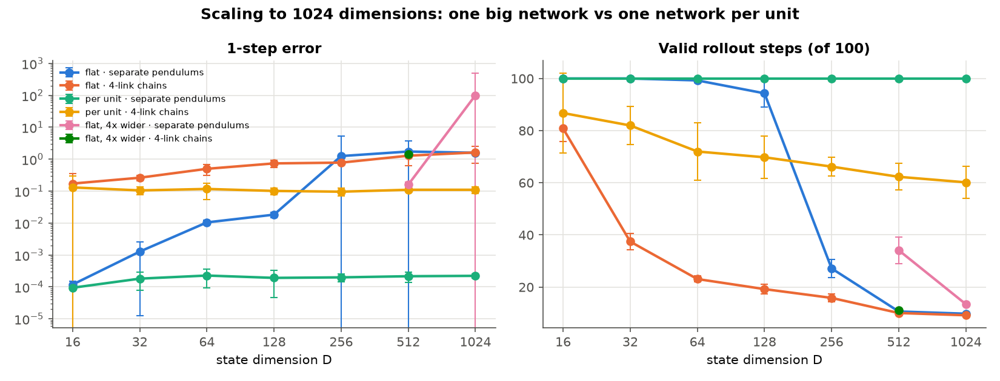
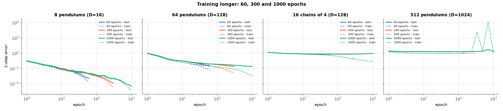
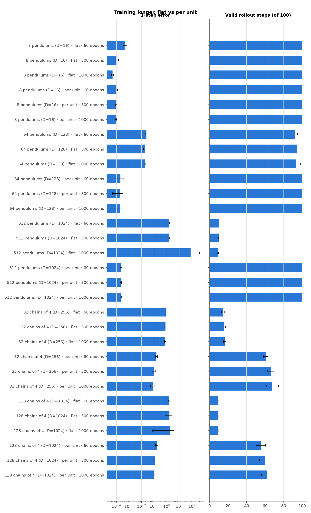
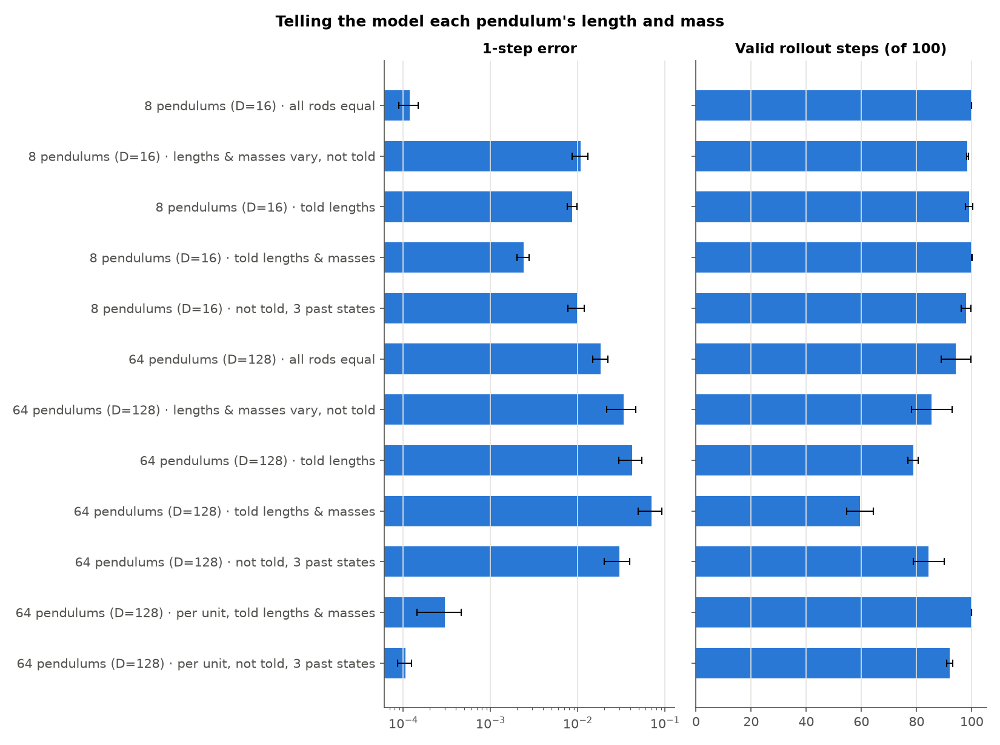
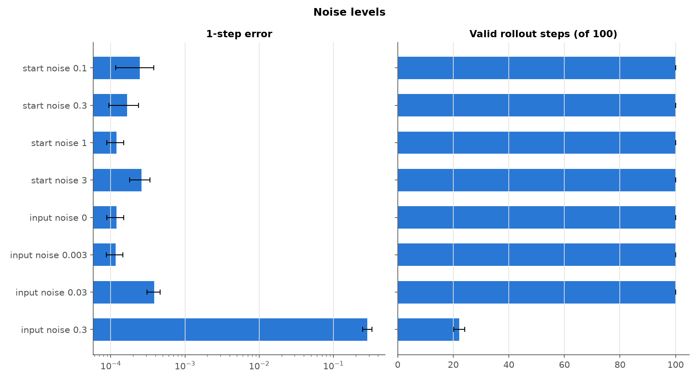
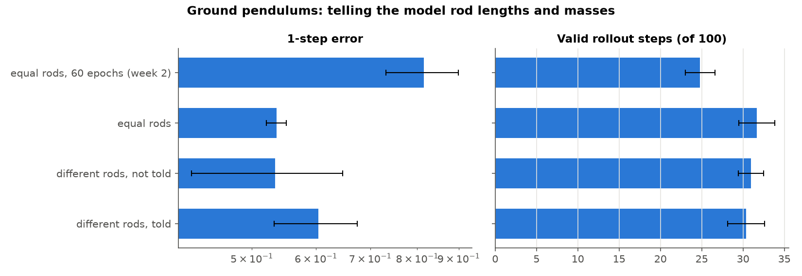

# Flow-matching experiment report

Mean ± 95% confidence interval over seeds (each seed = new clips + new network start).

* **1-step error**: squared one-step error ÷ variance of the true one-step change (1.0 = no better than guessing the average change).
* **rollout error @h**: error after h steps on the model's own predictions, in units of the state's spread (0.5 = clearly off).
* **valid steps**: steps until the rollout error first passes 0.5 (max 100).
* **test/train gap**: test 1-step error ÷ training 1-step error (≫1 = memorised).
* **shuffle X**: relative growth of the 1-step error when X is scrambled between test examples (≈0 = X is ignored).

## Hanging vs ground pendulum

*How much harder is the original ground setup than a freely hanging pendulum?*

| variant | run | D | 1-step error | rollout error @25 | valid steps | test/train gap | steps touching floor |
|---|---|---|---|---|---|---|---|
| hanging | `hang_P8` | 16 | 5.09e-04 ± 1.86e-04 | 0.014 ± 0.000 | 100.0 ± 0.0 | 2.697 ± 0.726 | – |
| ground | `ground_P8` | 16 | 0.816 ± 0.084 | 0.622 ± 0.113 | 24.8 ± 1.8 | 0.977 ± 0.069 | 0.802 ± 0.004 |

## Does the model learn the floor?

*In the ground setup, do predicted rods respect the floor, and are contact steps the hard part?*

| variant | run | D | 1-step error | rollout error @25 | valid steps | test/train gap | 1-step, no contact | 1-step, contact | >5 cm in floor (truth) | >5 cm in floor (model) | deepest, model (cm) |
|---|---|---|---|---|---|---|---|---|---|---|---|
| 8 pendulums | `ground_P8` | 16 | 0.816 ± 0.084 | 0.622 ± 0.113 | 24.8 ± 1.8 | 0.977 ± 0.069 | 0.459 ± 0.147 | 0.903 ± 0.134 | 0.000 ± 0.000 | 0.591 ± 0.047 | 27.1 ± 0.8 |
| chain of 2 | `ground_L2` | 4 | 0.739 ± 0.067 | 0.357 ± 0.070 | 33.4 ± 4.1 | 0.937 ± 0.294 | 0.636 ± 0.216 | 0.781 ± 0.047 | 0.000 ± 0.000 | 0.233 ± 0.103 | 15.0 ± 3.9 |
| chain of 4 | `ground_L4` | 8 | 0.795 ± 0.075 | 0.541 ± 0.243 | 27.8 ± 3.4 | 0.998 ± 0.210 | 0.581 ± 0.219 | 0.865 ± 0.041 | 0.000 ± 0.000 | 0.310 ± 0.033 | 30.3 ± 3.0 |
| chain of 8 | `ground_L8` | 16 | 0.816 ± 0.035 | 0.653 ± 0.052 | 25.4 ± 1.5 | 1.044 ± 0.183 | 0.401 ± 0.141 | 0.956 ± 0.096 | 6.67e-05 ± 2.87e-04 | 0.424 ± 0.073 | 68.4 ± 28.1 |

## More pendulums vs longer chains

*Is it the size of the state (D) or the coupling between joints that makes prediction hard?*

| variant | run | D | 1-step error | rollout error @25 | valid steps | test/train gap |
|---|---|---|---|---|---|---|
| hanging · 1 pendulum | `hang_P1` | 2 | 2.06e-05 ± 6.96e-06 | 2.41e-03 ± 1.37e-03 | 100.0 ± 0.0 | 1.294 ± 0.596 |
| hanging · 2 pendulums | `hang_P2` | 4 | 4.32e-05 ± 1.88e-05 | 3.55e-03 ± 8.44e-04 | 100.0 ± 0.0 | 1.481 ± 0.847 |
| hanging · 4 pendulums | `hang_P4` | 8 | 1.04e-04 ± 1.99e-05 | 5.94e-03 ± 3.30e-04 | 100.0 ± 0.0 | 1.699 ± 0.562 |
| hanging · 8 pendulums | `hang_P8` | 16 | 5.09e-04 ± 1.86e-04 | 0.014 ± 0.000 | 100.0 ± 0.0 | 2.697 ± 0.726 |
| hanging · chain of 2 | `hang_L2` | 4 | 0.018 ± 0.029 | 8.29e-03 ± 2.33e-03 | 100.0 ± 0.0 | 6.286 ± 5.507 |
| hanging · chain of 4 | `hang_L4` | 8 | 0.074 ± 0.040 | 0.063 ± 0.009 | 89.8 ± 5.4 | 2.659 ± 2.524 |
| hanging · chain of 8 | `hang_L8` | 16 | 0.461 ± 0.160 | 0.417 ± 0.125 | 37.5 ± 6.2 | 2.895 ± 2.619 |
| ground · 1 pendulum | `ground_P1` | 2 | 0.591 ± 0.204 | 0.235 ± 0.256 | 39.1 ± 3.1 | 0.925 ± 0.290 |
| ground · 2 pendulums | `ground_P2` | 4 | 0.714 ± 0.236 | 0.340 ± 0.020 | 32.7 ± 1.4 | 0.945 ± 0.385 |
| ground · 4 pendulums | `ground_P4` | 8 | 0.740 ± 0.028 | 0.546 ± 0.151 | 27.1 ± 2.2 | 0.907 ± 0.163 |
| ground · 8 pendulums | `ground_P8` | 16 | 0.816 ± 0.084 | 0.622 ± 0.113 | 24.8 ± 1.8 | 0.977 ± 0.069 |
| ground · chain of 2 | `ground_L2` | 4 | 0.739 ± 0.067 | 0.357 ± 0.070 | 33.4 ± 4.1 | 0.937 ± 0.294 |
| ground · chain of 4 | `ground_L4` | 8 | 0.795 ± 0.075 | 0.541 ± 0.243 | 27.8 ± 3.4 | 0.998 ± 0.210 |
| ground · chain of 8 | `ground_L8` | 16 | 0.816 ± 0.035 | 0.653 ± 0.052 | 25.4 ± 1.5 | 1.044 ± 0.183 |

## Flow matching vs regression, change vs next state

*Which model and which prediction target work best on the hanging setup?*

| variant | run | D | 1-step error | rollout error @25 | valid steps | test/train gap |
|---|---|---|---|---|---|---|
| flow matching · change | `hang_P8` | 16 | 5.09e-04 ± 1.86e-04 | 0.014 ± 0.000 | 100.0 ± 0.0 | 2.697 ± 0.726 |
| flow matching · next state | `hang_P8_state` | 16 | 0.017 ± 0.005 | 0.084 ± 0.013 | 99.7 ± 0.4 | 1.254 ± 0.224 |
| regression · change | `hang_P8_regression` | 16 | 8.22e-03 ± 2.88e-03 | 0.087 ± 0.011 | 98.8 ± 1.7 | 36.6 ± 7.1 |
| regression · next state | `hang_P8_regression_state` | 16 | 0.797 ± 0.082 | 0.801 ± 0.047 | 15.5 ± 2.1 | 11.5 ± 1.3 |

## Telling the model gravity

*When does it matter whether the model is told the gravity of a clip?*

| variant | run | D | 1-step error | rollout error @25 | valid steps | test/train gap | shuffle gravity |
|---|---|---|---|---|---|---|---|
| gravity fixed, not told | `g_fixed_hidden` | 16 | 1.67e-04 ± 1.27e-04 | 4.63e-03 ± 1.02e-03 | 100.0 ± 0.0 | 1.421 ± 0.320 | – |
| gravity varies, not told | `g_hidden` | 16 | 0.085 ± 0.015 | 0.230 ± 0.062 | 65.3 ± 1.8 | 18.6 ± 10.7 | – |
| gravity varies, told | `hang_P8` | 16 | 5.09e-04 ± 1.86e-04 | 0.014 ± 0.000 | 100.0 ± 0.0 | 2.697 ± 0.726 | 216.2 ± 49.0 |

## Gravities outside the training range

*Does a model trained on gravity 4-15 work at gravity 2, 20 or 25?*

| variant | run | D | 1-step error | rollout error @25 | valid steps | test/train gap | 1-step @ g=2 | 1-step @ g=9.81 | 1-step @ g=20 | 1-step @ g=25 |
|---|---|---|---|---|---|---|---|---|---|---|
| trained 4-15, told | `hang_P8` | 16 | 5.09e-04 ± 1.86e-04 | 0.014 ± 0.000 | 100.0 ± 0.0 | 2.697 ± 0.726 | 6.27e-03 ± 5.36e-03 | 3.67e-04 ± 9.26e-05 | 0.027 ± 0.002 | 0.196 ± 0.039 |
| trained 4-15, not told | `g_hidden` | 16 | 0.085 ± 0.015 | 0.230 ± 0.062 | 65.3 ± 1.8 | 18.6 ± 10.7 | 0.283 ± 0.069 | 0.042 ± 0.006 | 0.387 ± 0.118 | 0.842 ± 0.138 |
| trained 2-25, told | `g_wide_told` | 16 | 7.62e-04 ± 1.87e-04 | 0.024 ± 0.005 | 100.0 ± 0.0 | 3.267 ± 0.922 | 9.32e-04 ± 3.66e-04 | 4.66e-04 ± 2.47e-04 | 6.99e-04 ± 2.00e-04 | 2.19e-03 ± 5.61e-04 |
| trained at 9.81 only | `g_fixed_hidden` | 16 | 1.67e-04 ± 1.27e-04 | 4.63e-03 ± 1.02e-03 | 100.0 ± 0.0 | 1.421 ± 0.320 | 0.353 ± 0.020 | 1.59e-04 ± 9.82e-05 | 0.501 ± 0.026 | 1.142 ± 0.165 |

## Joint damping

*Does friction that varies between clips hurt, and does telling the model fix it?*

| variant | run | D | 1-step error | rollout error @25 | valid steps | test/train gap | shuffle damping |
|---|---|---|---|---|---|---|---|
| no damping | `hang_P8` | 16 | 5.09e-04 ± 1.86e-04 | 0.014 ± 0.000 | 100.0 ± 0.0 | 2.697 ± 0.726 | – |
| same damping every clip, not told | `damp_fixed_hidden` | 16 | 1.63e-03 ± 3.69e-04 | 0.053 ± 0.011 | 100.0 ± 0.0 | 5.811 ± 1.451 | – |
| damping varies, not told | `damp_hidden` | 16 | 0.018 ± 0.005 | 0.245 ± 0.044 | 80.3 ± 12.0 | 8.438 ± 1.238 | – |
| damping varies, told | `damp_told` | 16 | 3.23e-03 ± 1.27e-03 | 0.074 ± 0.006 | 99.7 ± 0.6 | 6.189 ± 2.169 | 8.029 ± 1.117 |

## Past states as context

*Do 2-5 past states help, and when?*

| variant | run | D | 1-step error | rollout error @25 | valid steps | test/train gap | shuffle gravity |
|---|---|---|---|---|---|---|---|
| full · told · K=1 | `hang_P8` | 16 | 5.09e-04 ± 1.86e-04 | 0.014 ± 0.000 | 100.0 ± 0.0 | 2.697 ± 0.726 | 216.2 ± 49.0 |
| full · told · K=2 | `ctx_full_told_K2` | 16 | 4.42e-04 ± 1.15e-04 | 0.014 ± 0.002 | 100.0 ± 0.0 | 2.543 ± 0.553 | 245.0 ± 45.9 |
| full · told · K=3 | `ctx_full_told_K3` | 16 | 4.67e-04 ± 7.25e-05 | 0.014 ± 0.004 | 100.0 ± 0.0 | 2.467 ± 0.520 | 225.0 ± 31.5 |
| full · told · K=5 | `ctx_full_told_K5` | 16 | 4.44e-04 ± 5.47e-05 | 0.015 ± 0.004 | 100.0 ± 0.0 | 2.426 ± 0.228 | 211.0 ± 41.3 |
| full · not told · K=1 | `g_hidden` | 16 | 0.085 ± 0.015 | 0.230 ± 0.062 | 65.3 ± 1.8 | 18.6 ± 10.7 | – |
| full · not told · K=2 | `ctx_full_hidden_K2` | 16 | 0.080 ± 0.011 | 0.228 ± 0.065 | 64.2 ± 8.3 | 28.4 ± 8.6 | – |
| full · not told · K=3 | `ctx_full_hidden_K3` | 16 | 0.070 ± 0.012 | 0.235 ± 0.036 | 62.4 ± 10.3 | 36.0 ± 10.2 | – |
| full · not told · K=5 | `ctx_full_hidden_K5` | 16 | 0.017 ± 0.006 | 0.176 ± 0.042 | 69.4 ± 3.4 | 22.4 ± 11.5 | – |
| positions · told · K=1 | `ctx_pos_told_K1` | 16 | 1.561 ± 0.041 | 1.631 ± 0.087 | 9.607 ± 0.576 | 21.6 ± 4.9 | -9.84e-03 ± 3.37e-02 |
| positions · told · K=2 | `ctx_pos_told_K2` | 16 | 3.15e-04 ± 6.08e-05 | 0.144 ± 0.011 | 89.8 ± 6.5 | 3.099 ± 0.608 | 1.975 ± 0.217 |
| positions · told · K=3 | `ctx_pos_told_K3` | 16 | 1.51e-04 ± 5.62e-05 | 0.080 ± 0.020 | 99.4 ± 0.9 | 1.795 ± 0.235 | 9.686 ± 1.748 |
| positions · told · K=5 | `ctx_pos_told_K5` | 16 | 1.08e-04 ± 4.14e-05 | 0.041 ± 0.000 | 100.0 ± 0.0 | 1.815 ± 0.247 | 39.1 ± 13.9 |

## Random nuisance tokens

*Does the model ignore meaningless random inputs, or learn from them?*

| variant | run | D | 1-step error | rollout error @25 | valid steps | test/train gap | shuffle tokens | shuffle gravity |
|---|---|---|---|---|---|---|---|---|
| no tokens | `hang_P8` | 16 | 5.09e-04 ± 1.86e-04 | 0.014 ± 0.000 | 100.0 ± 0.0 | 2.697 ± 0.726 | – | 216.2 ± 49.0 |
| 8 tokens, new every step | `tok8_step` | 16 | 5.16e-04 ± 1.34e-04 | 0.014 ± 0.005 | 100.0 ± 0.0 | 2.723 ± 0.966 | -2.43e-04 ± 1.61e-03 | 212.8 ± 49.2 |
| 8 tokens, fixed per clip | `tok8_clip` | 16 | 6.36e-04 ± 1.20e-04 | 0.017 ± 0.004 | 100.0 ± 0.0 | 3.207 ± 0.562 | 0.012 ± 0.040 | 171.0 ± 10.9 |
| 32 tokens, fixed per clip | `tok32_clip` | 16 | 1.76e-03 ± 8.66e-04 | 0.029 ± 0.002 | 100.0 ± 0.0 | 6.988 ± 2.786 | 0.024 ± 0.043 | 60.9 ± 20.0 |
| no tokens, gravity not told | `g_hidden` | 16 | 0.085 ± 0.015 | 0.230 ± 0.062 | 65.3 ± 1.8 | 18.6 ± 10.7 | – | – |
| 32 tokens per clip, gravity not told | `tok32_clip_hidden` | 16 | 0.083 ± 0.012 | 0.218 ± 0.028 | 64.0 ± 3.5 | 141.0 ± 1.9 | -0.036 ± 0.219 | – |

## Other worlds

*How do springs, cart-poles and bouncing balls compare to the hanging pendulum at the same D?*

| variant | run | D | 1-step error | rollout error @25 | valid steps | test/train gap | copy baseline 1-step |
|---|---|---|---|---|---|---|---|
| spring chains | `spring_D16` | 16 | 1.89e-05 ± 1.03e-06 | 5.73e-03 ± 1.01e-03 | 100.0 ± 0.0 | 1.146 ± 0.121 | 0.996 ± 0.019 |
| hanging pendulums | `hang_P8` | 16 | 5.09e-04 ± 1.86e-04 | 0.014 ± 0.000 | 100.0 ± 0.0 | 2.697 ± 0.726 | 0.981 ± 0.141 |
| cart-poles | `cartpole_D16` | 16 | 0.032 ± 0.080 | 0.033 ± 0.014 | 96.8 ± 2.7 | 12.4 ± 28.5 | 0.977 ± 0.136 |
| bouncing balls | `balls_D16` | 16 | 0.412 ± 0.022 | 0.259 ± 0.033 | 32.1 ± 5.7 | 0.952 ± 0.186 | 0.946 ± 0.056 |

## Scaling the state: 16 to 128 dimensions

*How does the model cope as the state grows from D = 16 to 128, with independent joints and with coupled ones?*

| variant | run | D | 1-step error | rollout error @25 | valid steps | test/train gap |
|---|---|---|---|---|---|---|
| separate pendulums · D=16 | `hang_P8` | 16 | 5.09e-04 ± 1.86e-04 | 0.014 ± 0.000 | 100.0 ± 0.0 | 2.697 ± 0.726 |
| separate pendulums · D=32 | `dim_P16` | 32 | 6.79e-03 ± 2.48e-03 | 0.052 ± 0.004 | 100.0 ± 0.0 | 3.752 ± 1.192 |
| separate pendulums · D=64 | `dim_P32` | 64 | 0.012 ± 0.003 | 0.072 ± 0.005 | 99.3 ± 1.5 | 2.826 ± 0.433 |
| separate pendulums · D=128 | `dim_P64` | 128 | 0.025 ± 0.003 | 0.113 ± 0.002 | 92.0 ± 2.9 | 3.159 ± 0.375 |
| 4-link chains · D=16 | `dim_L4x2` | 16 | 0.238 ± 0.198 | 0.198 ± 0.068 | 65.8 ± 4.2 | 4.847 ± 3.251 |
| 4-link chains · D=32 | `dim_L4x4` | 32 | 0.327 ± 0.050 | 0.425 ± 0.036 | 35.2 ± 4.3 | 1.827 ± 0.317 |
| 4-link chains · D=64 | `dim_L4x8` | 64 | 0.663 ± 0.247 | 0.599 ± 0.053 | 22.5 ± 2.5 | 1.625 ± 0.712 |
| 4-link chains · D=128 | `dim_L4x16` | 128 | 0.712 ± 0.078 | 0.643 ± 0.031 | 20.6 ± 1.8 | 1.264 ± 0.201 |

## Scaling to 1024 dimensions: one big network vs one network per unit

*How far can the state grow before the model breaks, and does cutting it into units help?*

| variant | run | D | network weights | updates | 1-step error | rollout error @25 | valid steps | test/train gap | train 1-step |
|---|---|---|---|---|---|---|---|---|---|
| flat · separate pendulums · D=16 | `flat_P8` | 16 | 427,024 | 23,700 | 1.19e-04 ± 3.01e-05 | 6.97e-03 ± 1.26e-03 | 100.0 ± 0.0 | 3.027 ± 0.506 | 3.93e-05 ± 8.82e-06 |
| flat · separate pendulums · D=32 | `flat_P16` | 32 | 439,328 | 23,700 | 1.28e-03 ± 1.27e-03 | 0.022 ± 0.007 | 100.0 ± 0.0 | 8.385 ± 6.604 | 1.50e-04 ± 3.57e-05 |
| flat · separate pendulums · D=64 | `flat_P32` | 64 | 463,936 | 23,700 | 0.011 ± 0.002 | 0.067 ± 0.009 | 99.3 ± 1.0 | 8.679 ± 0.698 | 1.21e-03 ± 2.20e-04 |
| flat · separate pendulums · D=128 | `flat_P64` | 128 | 513,152 | 23,700 | 0.018 ± 0.004 | 0.094 ± 0.003 | 94.3 ± 5.3 | 6.819 ± 3.295 | 2.74e-03 ± 8.52e-04 |
| flat · separate pendulums · D=256 | `flat_P128` | 256 | 611,584 | 23,700 | 1.256 ± 4.049 | 0.471 ± 0.044 | 27.1 ± 3.6 | 9.605 ± 32.543 | 0.145 ± 0.041 |
| flat · separate pendulums · D=512 | `flat_P256` | 512 | 808,448 | 23,700 | 1.742 ± 2.069 | 2.031 ± 4.075 | 10.6 ± 0.2 | 2.711 ± 2.726 | 0.631 ± 0.105 |
| flat · separate pendulums · D=1024 | `flat_P512` | 1024 | 1,202,176 | 23,700 | 1.593 ± 0.090 | 1.135 ± 0.005 | 9.787 ± 0.304 | 1.241 ± 2.504 | 7.269 ± 27.468 |
| flat · 4-link chains · D=16 | `flat_L4x2` | 16 | 427,024 | 23,700 | 0.173 ± 0.177 | 0.125 ± 0.029 | 80.8 ± 5.0 | 71.8 ± 81.5 | 2.43e-03 ± 4.45e-04 |
| flat · 4-link chains · D=32 | `flat_L4x4` | 32 | 439,328 | 23,700 | 0.264 ± 0.049 | 0.383 ± 0.034 | 37.4 ± 3.2 | 21.8 ± 4.1 | 0.012 ± 0.000 |
| flat · 4-link chains · D=64 | `flat_L4x8` | 64 | 463,936 | 23,700 | 0.501 ± 0.192 | 0.595 ± 0.041 | 23.1 ± 1.2 | 10.8 ± 6.7 | 0.047 ± 0.010 |
| flat · 4-link chains · D=128 | `flat_L4x16` | 128 | 513,152 | 23,700 | 0.740 ± 0.190 | 0.672 ± 0.023 | 19.2 ± 1.9 | 3.712 ± 1.057 | 0.200 ± 0.006 |
| flat · 4-link chains · D=256 | `flat_L4x32` | 256 | 611,584 | 23,700 | 0.783 ± 0.090 | 0.722 ± 0.031 | 15.8 ± 1.5 | 1.235 ± 0.147 | 0.634 ± 0.070 |
| flat · 4-link chains · D=512 | `flat_L4x64` | 512 | 808,448 | 23,700 | 1.290 ± 0.671 | 0.932 ± 0.009 | 10.1 ± 0.2 | 1.311 ± 0.713 | 0.985 ± 0.022 |
| flat · 4-link chains · D=1024 | `flat_L4x128` | 1024 | 1,202,176 | 23,700 | 1.631 ± 0.900 | 0.995 ± 0.014 | 9.193 ± 0.201 | 1.230 ± 0.679 | 1.326 ± 0.004 |
| per unit · separate pendulums · D=16 | `units_P8` | 16 | 416,258 | 23,700 | 9.44e-05 ± 1.27e-05 | 6.88e-03 ± 2.07e-03 | 100.0 ± 0.0 | 1.011 ± 0.305 | 9.45e-05 ± 3.64e-05 |
| per unit · separate pendulums · D=32 | `units_P16` | 32 | 416,258 | 23,700 | 1.82e-04 ± 1.04e-04 | 8.18e-03 ± 1.92e-03 | 100.0 ± 0.0 | 0.992 ± 0.305 | 1.85e-04 ± 1.15e-04 |
| per unit · separate pendulums · D=64 | `units_P32` | 64 | 416,258 | 23,700 | 2.28e-04 ± 1.36e-04 | 9.27e-03 ± 1.90e-03 | 100.0 ± 0.0 | 1.021 ± 0.131 | 2.22e-04 ± 1.08e-04 |
| per unit · separate pendulums · D=128 | `units_P64` | 128 | 416,258 | 23,700 | 1.92e-04 ± 1.45e-04 | 9.44e-03 ± 3.02e-03 | 100.0 ± 0.0 | 0.964 ± 0.209 | 1.99e-04 ± 1.37e-04 |
| per unit · separate pendulums · D=256 | `units_P128` | 256 | 416,258 | 23,700 | 2.00e-04 ± 5.55e-05 | 9.48e-03 ± 5.31e-04 | 100.0 ± 0.0 | 0.948 ± 0.259 | 2.11e-04 ± 2.45e-05 |
| per unit · separate pendulums · D=512 | `units_P256` | 512 | 416,258 | 23,700 | 2.17e-04 ± 7.51e-05 | 9.93e-03 ± 1.15e-03 | 100.0 ± 0.0 | 0.946 ± 0.258 | 2.29e-04 ± 4.38e-05 |
| per unit · separate pendulums · D=1024 | `units_P512` | 1024 | 416,258 | 23,700 | 2.23e-04 ± 3.22e-05 | 0.010 ± 0.001 | 100.0 ± 0.0 | 0.946 ± 0.197 | 2.36e-04 ± 4.14e-05 |
| per unit · 4-link chains · D=16 | `units_L4x2` | 16 | 420,872 | 23,700 | 0.131 ± 0.167 | 0.101 ± 0.040 | 86.8 ± 15.4 | 23.1 ± 19.2 | 5.48e-03 ± 2.37e-03 |
| per unit · 4-link chains · D=32 | `units_L4x4` | 32 | 420,872 | 23,700 | 0.105 ± 0.029 | 0.114 ± 0.062 | 82.0 ± 7.4 | 4.138 ± 2.588 | 0.027 ± 0.017 |
| per unit · 4-link chains · D=64 | `units_L4x8` | 64 | 420,872 | 23,700 | 0.117 ± 0.062 | 0.133 ± 0.045 | 72.0 ± 11.0 | 2.170 ± 0.629 | 0.054 ± 0.014 |
| per unit · 4-link chains · D=128 | `units_L4x16` | 128 | 420,872 | 23,700 | 0.102 ± 0.025 | 0.136 ± 0.045 | 69.8 ± 8.2 | 1.217 ± 0.315 | 0.084 ± 0.026 |
| per unit · 4-link chains · D=256 | `units_L4x32` | 256 | 420,872 | 23,700 | 0.096 ± 0.027 | 0.143 ± 0.024 | 66.2 ± 3.5 | 0.980 ± 0.204 | 0.098 ± 0.009 |
| per unit · 4-link chains · D=512 | `units_L4x64` | 512 | 420,872 | 23,700 | 0.110 ± 0.006 | 0.148 ± 0.011 | 62.3 ± 5.1 | 0.964 ± 0.061 | 0.115 ± 0.005 |
| per unit · 4-link chains · D=1024 | `units_L4x128` | 1024 | 420,872 | 23,700 | 0.110 ± 0.027 | 0.147 ± 0.026 | 60.2 ± 6.2 | 0.903 ± 0.179 | 0.122 ± 0.012 |
| flat, 4x wider · separate pendulums · D=512 | `wide_P256` | 512 | 7,950,848 | 23,700 | 0.160 ± 0.030 | 0.413 ± 0.038 | 34.1 ± 5.1 | 33.3 ± 17.6 | 4.92e-03 ± 1.98e-03 |
| flat, 4x wider · 4-link chains · D=512 | `wide_L4x64` | 512 | 7,950,848 | 23,700 | 1.409 ± 0.128 | 0.984 ± 0.051 | 11.1 ± 0.6 | 23.0 ± 1.1 | 0.061 ± 0.005 |
| flat, 4x wider · separate pendulums · D=1024 | `wide_P512` | 1024 | 9,524,224 | 23,700 | 100.6 ± 405.7 | 2.447 ± 2.896 | 13.4 ± 0.7 | 709.7 ± 2874.1 | 0.137 ± 0.044 |

## Training longer: 60, 300 and 1000 epochs

*Does more training help, and when does the model start to memorise?*

| variant | run | D | epochs | updates | 1-step error | rollout error @25 | valid steps | test/train gap | train 1-step | train loss (last epoch) | test loss |
|---|---|---|---|---|---|---|---|---|---|---|---|
| 8 pendulums (D=16) · 60 epochs | `hang_P8` | 16 | 60 | 4,740 | 5.09e-04 ± 1.86e-04 | 0.014 ± 0.000 | 100.0 ± 0.0 | 2.697 ± 0.726 | 1.88e-04 ± 1.93e-05 | 0.022 ± 0.001 | 0.038 ± 0.020 |
| 8 pendulums (D=16) · 300 epochs | `flat_P8` | 16 | 300 | 23,700 | 1.19e-04 ± 3.01e-05 | 6.97e-03 ± 1.26e-03 | 100.0 ± 0.0 | 3.027 ± 0.506 | 3.93e-05 ± 8.82e-06 | 9.86e-03 ± 4.72e-04 | 0.018 ± 0.012 |
| 8 pendulums (D=16) · 1000 epochs | `flat_P8_e1000` | 16 | 1,000 | 79,000 | 4.94e-05 ± 8.06e-06 | 4.54e-03 ± 1.03e-03 | 100.0 ± 0.0 | 3.846 ± 0.422 | 1.29e-05 ± 2.91e-06 | 4.96e-03 ± 1.52e-03 | 0.011 ± 0.008 |
| 64 pendulums (D=128) · 60 epochs | `dim_P64` | 128 | 60 | 4,740 | 0.025 ± 0.003 | 0.113 ± 0.002 | 92.0 ± 2.9 | 3.159 ± 0.375 | 7.76e-03 ± 4.94e-05 | 0.098 ± 0.001 | 0.233 ± 0.068 |
| 64 pendulums (D=128) · 300 epochs | `flat_P64` | 128 | 300 | 23,700 | 0.018 ± 0.004 | 0.094 ± 0.003 | 94.3 ± 5.3 | 6.819 ± 3.295 | 2.74e-03 ± 8.52e-04 | 0.055 ± 0.005 | 0.236 ± 0.100 |
| 64 pendulums (D=128) · 1000 epochs | `flat_P64_e1000` | 128 | 1,000 | 79,000 | 0.019 ± 0.003 | 0.090 ± 0.003 | 93.6 ± 4.8 | 17.2 ± 14.1 | 1.17e-03 ± 9.67e-04 | 0.039 ± 0.005 | 0.305 ± 0.176 |
| 16 chains of 4 (D=128) · 60 epochs | `dim_L4x16` | 128 | 60 | 4,740 | 0.712 ± 0.078 | 0.643 ± 0.031 | 20.6 ± 1.8 | 1.264 ± 0.201 | 0.564 ± 0.030 | 0.543 ± 0.018 | 0.692 ± 0.066 |
| 16 chains of 4 (D=128) · 300 epochs | `flat_L4x16` | 128 | 300 | 23,700 | 0.740 ± 0.190 | 0.672 ± 0.023 | 19.2 ± 1.9 | 3.712 ± 1.057 | 0.200 ± 0.006 | 0.356 ± 0.008 | 1.077 ± 0.204 |
| 16 chains of 4 (D=128) · 1000 epochs | `flat_L4x16_e1000` | 128 | 1,000 | 79,000 | 0.879 ± 0.237 | 0.810 ± 0.070 | 16.0 ± 1.8 | 10.6 ± 2.8 | 0.083 ± 0.002 | 0.244 ± 0.005 | 1.907 ± 0.396 |
| 512 pendulums (D=1024) · 60 epochs | `flat_P512_e60` | 1024 | 60 | 4,740 | 1.563 ± 0.094 | 1.104 ± 0.011 | 10.1 ± 0.2 | 1.734 ± 0.098 | 0.901 ± 0.005 | 0.959 ± 0.005 | 1.829 ± 0.073 |
| 512 pendulums (D=1024) · 300 epochs | `flat_P512` | 1024 | 300 | 23,700 | 1.593 ± 0.090 | 1.135 ± 0.005 | 9.787 ± 0.304 | 1.241 ± 2.504 | 7.269 ± 27.468 | 0.916 ± 0.008 | 2.307 ± 0.124 |
| 512 pendulums (D=1024) · 1000 epochs | `flat_P512_e1000` | 1024 | 1,000 | 79,000 | 78.0 ± 327.0 | 1.848 ± 2.829 | 9.187 ± 0.316 | 44.0 ± 179.9 | 1.188 ± 1.321 | 0.904 ± 0.009 | 3.299 ± 0.389 |

## Training longer, flat vs per unit

*Does the per-unit network also memorise when trained longer, or only the flat one?*

| variant | run | D | epochs | updates | 1-step error | rollout error @25 | valid steps | test/train gap |
|---|---|---|---|---|---|---|---|---|
| 8 pendulums (D=16) · flat · 60 epochs | `hang_P8` | 16 | 60 | 4,740 | 5.09e-04 ± 1.86e-04 | 0.014 ± 0.000 | 100.0 ± 0.0 | 2.697 ± 0.726 |
| 8 pendulums (D=16) · flat · 300 epochs | `flat_P8` | 16 | 300 | 23,700 | 1.19e-04 ± 3.01e-05 | 6.97e-03 ± 1.26e-03 | 100.0 ± 0.0 | 3.027 ± 0.506 |
| 8 pendulums (D=16) · flat · 1000 epochs | `flat_P8_e1000` | 16 | 1,000 | 79,000 | 4.94e-05 ± 8.06e-06 | 4.54e-03 ± 1.03e-03 | 100.0 ± 0.0 | 3.846 ± 0.422 |
| 8 pendulums (D=16) · per unit · 60 epochs | `units_P8_e60` | 16 | 60 | 4,740 | 1.08e-04 ± 1.45e-05 | 7.24e-03 ± 2.32e-03 | 100.0 ± 0.0 | 0.943 ± 0.199 |
| 8 pendulums (D=16) · per unit · 300 epochs | `units_P8` | 16 | 300 | 23,700 | 9.44e-05 ± 1.27e-05 | 6.88e-03 ± 2.07e-03 | 100.0 ± 0.0 | 1.011 ± 0.305 |
| 8 pendulums (D=16) · per unit · 1000 epochs | `units_P8_e1000` | 16 | 1,000 | 79,000 | 9.03e-05 ± 1.61e-05 | 6.74e-03 ± 2.17e-03 | 100.0 ± 0.0 | 1.008 ± 0.298 |
| 64 pendulums (D=128) · flat · 60 epochs | `dim_P64` | 128 | 60 | 4,740 | 0.025 ± 0.003 | 0.113 ± 0.002 | 92.0 ± 2.9 | 3.159 ± 0.375 |
| 64 pendulums (D=128) · flat · 300 epochs | `flat_P64` | 128 | 300 | 23,700 | 0.018 ± 0.004 | 0.094 ± 0.003 | 94.3 ± 5.3 | 6.819 ± 3.295 |
| 64 pendulums (D=128) · flat · 1000 epochs | `flat_P64_e1000` | 128 | 1,000 | 79,000 | 0.019 ± 0.003 | 0.090 ± 0.003 | 93.6 ± 4.8 | 17.2 ± 14.1 |
| 64 pendulums (D=128) · per unit · 60 epochs | `units_P64_e60` | 128 | 60 | 4,740 | 2.09e-04 ± 1.45e-04 | 9.68e-03 ± 2.94e-03 | 100.0 ± 0.0 | 0.979 ± 0.253 |
| 64 pendulums (D=128) · per unit · 300 epochs | `units_P64` | 128 | 300 | 23,700 | 1.92e-04 ± 1.45e-04 | 9.44e-03 ± 3.02e-03 | 100.0 ± 0.0 | 0.964 ± 0.209 |
| 64 pendulums (D=128) · per unit · 1000 epochs | `units_P64_e1000` | 128 | 1,000 | 79,000 | 1.87e-04 ± 1.48e-04 | 9.35e-03 ± 3.07e-03 | 100.0 ± 0.0 | 0.963 ± 0.221 |
| 512 pendulums (D=1024) · flat · 60 epochs | `flat_P512_e60` | 1024 | 60 | 4,740 | 1.563 ± 0.094 | 1.104 ± 0.011 | 10.1 ± 0.2 | 1.734 ± 0.098 |
| 512 pendulums (D=1024) · flat · 300 epochs | `flat_P512` | 1024 | 300 | 23,700 | 1.593 ± 0.090 | 1.135 ± 0.005 | 9.787 ± 0.304 | 1.241 ± 2.504 |
| 512 pendulums (D=1024) · flat · 1000 epochs | `flat_P512_e1000` | 1024 | 1,000 | 79,000 | 78.0 ± 327.0 | 1.848 ± 2.829 | 9.187 ± 0.316 | 44.0 ± 179.9 |
| 512 pendulums (D=1024) · per unit · 60 epochs | `units_P512_e60` | 1024 | 60 | 4,740 | 2.38e-04 ± 3.74e-05 | 0.010 ± 0.001 | 100.0 ± 0.0 | 0.964 ± 0.205 |
| 512 pendulums (D=1024) · per unit · 300 epochs | `units_P512` | 1024 | 300 | 23,700 | 2.23e-04 ± 3.22e-05 | 0.010 ± 0.001 | 100.0 ± 0.0 | 0.946 ± 0.197 |
| 512 pendulums (D=1024) · per unit · 1000 epochs | `units_P512_e1000` | 1024 | 1,000 | 79,000 | 2.19e-04 ± 3.29e-05 | 9.99e-03 ± 7.70e-04 | 100.0 ± 0.0 | 0.944 ± 0.201 |
| 32 chains of 4 (D=256) · flat · 60 epochs | `flat_L4x32_e60` | 256 | 60 | 4,740 | 0.819 ± 0.102 | 0.761 ± 0.039 | 14.6 ± 1.7 | 1.026 ± 0.082 |
| 32 chains of 4 (D=256) · flat · 300 epochs | `flat_L4x32` | 256 | 300 | 23,700 | 0.783 ± 0.090 | 0.722 ± 0.031 | 15.8 ± 1.5 | 1.235 ± 0.147 |
| 32 chains of 4 (D=256) · flat · 1000 epochs | `flat_L4x32_e1000` | 256 | 1,000 | 79,000 | 0.757 ± 0.092 | 0.702 ± 0.015 | 16.3 ± 1.5 | 1.403 ± 0.253 |
| 32 chains of 4 (D=256) · per unit · 60 epochs | `units_L4x32_e60` | 256 | 60 | 4,740 | 0.153 ± 0.031 | 0.163 ± 0.029 | 60.5 ± 2.6 | 0.887 ± 0.181 |
| 32 chains of 4 (D=256) · per unit · 300 epochs | `units_L4x32` | 256 | 300 | 23,700 | 0.096 ± 0.027 | 0.143 ± 0.024 | 66.2 ± 3.5 | 0.980 ± 0.204 |
| 32 chains of 4 (D=256) · per unit · 1000 epochs | `units_L4x32_e1000` | 256 | 1,000 | 79,000 | 0.081 ± 0.029 | 0.136 ± 0.020 | 67.9 ± 6.5 | 1.347 ± 0.500 |
| 128 chains of 4 (D=1024) · flat · 60 epochs | `flat_L4x128_e60` | 1024 | 60 | 4,740 | 1.460 ± 0.120 | 0.995 ± 0.015 | 9.207 ± 0.143 | 1.093 ± 0.090 |
| 128 chains of 4 (D=1024) · flat · 300 epochs | `flat_L4x128` | 1024 | 300 | 23,700 | 1.631 ± 0.900 | 0.995 ± 0.014 | 9.193 ± 0.201 | 1.230 ± 0.679 |
| 128 chains of 4 (D=1024) · flat · 1000 epochs | `flat_L4x128_e1000` | 1024 | 1,000 | 79,000 | 1.898 ± 1.822 | 0.998 ± 0.016 | 9.187 ± 0.229 | 1.434 ± 1.368 |
| 128 chains of 4 (D=1024) · per unit · 60 epochs | `units_L4x128_e60` | 1024 | 60 | 4,740 | 0.167 ± 0.040 | 0.170 ± 0.029 | 55.3 ± 5.1 | 0.890 ± 0.166 |
| 128 chains of 4 (D=1024) · per unit · 300 epochs | `units_L4x128` | 1024 | 300 | 23,700 | 0.110 ± 0.027 | 0.147 ± 0.026 | 60.2 ± 6.2 | 0.903 ± 0.179 |
| 128 chains of 4 (D=1024) · per unit · 1000 epochs | `units_L4x128_e1000` | 1024 | 1,000 | 79,000 | 0.090 ± 0.023 | 0.144 ± 0.023 | 62.4 ± 6.2 | 0.934 ± 0.237 |

## Telling the model each pendulum's length and mass

*Which physical parameters does the model need to be told, and which can it work out itself?*

| variant | run | D | inputs besides the state | 1-step error | rollout error @25 | valid steps | test/train gap | shuffle length | shuffle mass | shuffle gravity |
|---|---|---|---|---|---|---|---|---|---|---|
| 8 pendulums (D=16) · all rods equal | `flat_P8` | 16 | 1 | 1.19e-04 ± 3.01e-05 | 6.97e-03 ± 1.26e-03 | 100.0 ± 0.0 | 3.027 ± 0.506 | – | – | 933.0 ± 290.4 |
| 8 pendulums (D=16) · lengths & masses vary, not told | `par_P8_hidden` | 16 | 1 | 0.011 ± 0.002 | 0.080 ± 0.014 | 98.4 ± 0.3 | 38.2 ± 8.6 | – | – | 9.635 ± 3.859 |
| 8 pendulums (D=16) · told lengths | `par_P8_length` | 16 | 9 | 8.67e-03 ± 1.09e-03 | 0.069 ± 0.002 | 99.0 ± 1.3 | 43.8 ± 8.3 | 0.470 ± 0.343 | – | 11.9 ± 3.2 |
| 8 pendulums (D=16) · told lengths & masses | `par_P8_told` | 16 | 17 | 2.38e-03 ± 3.69e-04 | 0.036 ± 0.004 | 100.0 ± 0.1 | 24.1 ± 2.6 | 2.139 ± 0.589 | 2.949 ± 0.397 | 44.9 ± 7.3 |
| 8 pendulums (D=16) · not told, 3 past states | `par_P8_hidden_K3` | 16 | 1 | 9.81e-03 ± 2.13e-03 | 0.080 ± 0.010 | 97.9 ± 1.8 | 36.4 ± 12.3 | – | – | 9.136 ± 3.582 |
| 64 pendulums (D=128) · all rods equal | `flat_P64` | 128 | 1 | 0.018 ± 0.004 | 0.094 ± 0.003 | 94.3 ± 5.3 | 6.819 ± 3.295 | – | – | 4.786 ± 0.927 |
| 64 pendulums (D=128) · lengths & masses vary, not told | `par_P64_hidden` | 128 | 1 | 0.034 ± 0.012 | 0.151 ± 0.012 | 85.5 ± 7.3 | 5.460 ± 3.175 | – | – | 2.691 ± 0.729 |
| 64 pendulums (D=128) · told lengths | `par_P64_length` | 128 | 65 | 0.042 ± 0.013 | 0.179 ± 0.008 | 78.7 ± 1.9 | 8.270 ± 1.973 | -6.21e-03 ± 1.04e-02 | – | 1.836 ± 0.493 |
| 64 pendulums (D=128) · told lengths & masses | `par_P64_told` | 128 | 129 | 0.070 ± 0.021 | 0.263 ± 0.022 | 59.4 ± 4.9 | 16.0 ± 9.7 | 0.013 ± 0.040 | -5.14e-03 ± 4.36e-02 | 0.860 ± 0.459 |
| 64 pendulums (D=128) · not told, 3 past states | `par_P64_hidden_K3` | 128 | 1 | 0.030 ± 0.010 | 0.151 ± 0.003 | 84.4 ± 5.6 | 6.651 ± 2.288 | – | – | 2.572 ± 0.500 |
| 64 pendulums (D=128) · per unit, told lengths & masses | `par_P64_units_told` | 128 | 129 | 3.01e-04 ± 1.58e-04 | 0.012 ± 0.003 | 100.0 ± 0.0 | 0.987 ± 0.319 | 23.9 ± 17.2 | 29.5 ± 23.0 | 373.2 ± 313.8 |
| 64 pendulums (D=128) · per unit, not told, 3 past states | `par_P64_units_hidden_K3` | 128 | 1 | 1.05e-04 ± 1.93e-05 | 0.057 ± 0.009 | 91.9 ± 1.1 | 0.926 ± 0.207 | – | – | 3.533 ± 0.664 |

## Noise levels

*How do the size of the flow-matching start noise and noise on the input states affect the model?*

| variant | run | D | 1-step error | rollout error @25 | valid steps | test/train gap |
|---|---|---|---|---|---|---|
| start noise 0.1 | `fmnoise_0.1` | 16 | 2.48e-04 ± 1.31e-04 | 9.52e-03 ± 7.20e-04 | 100.0 ± 0.0 | 4.164 ± 2.225 |
| start noise 0.3 | `fmnoise_0.3` | 16 | 1.65e-04 ± 7.10e-05 | 8.00e-03 ± 3.73e-04 | 100.0 ± 0.0 | 5.609 ± 1.533 |
| start noise 1 | `flat_P8` | 16 | 1.19e-04 ± 3.01e-05 | 6.97e-03 ± 1.26e-03 | 100.0 ± 0.0 | 3.027 ± 0.506 |
| start noise 3 | `fmnoise_3` | 16 | 2.58e-04 ± 7.78e-05 | 9.43e-03 ± 1.43e-03 | 100.0 ± 0.0 | 1.832 ± 0.332 |
| input noise 0 | `flat_P8` | 16 | 1.19e-04 ± 3.01e-05 | 6.97e-03 ± 1.26e-03 | 100.0 ± 0.0 | 3.027 ± 0.506 |
| input noise 0.003 | `innoise_0.003` | 16 | 1.16e-04 ± 2.87e-05 | 6.92e-03 ± 4.11e-04 | 100.0 ± 0.0 | 2.988 ± 0.682 |
| input noise 0.03 | `innoise_0.03` | 16 | 3.84e-04 ± 7.78e-05 | 9.45e-03 ± 1.43e-03 | 100.0 ± 0.0 | 1.253 ± 0.189 |
| input noise 0.3 | `innoise_0.3` | 16 | 0.288 ± 0.041 | 0.593 ± 0.005 | 22.2 ± 2.0 | 13.8 ± 1.2 |

## Ground pendulums: telling the model rod lengths and masses

*With rods of different length on the floor, does telling the model the lengths and masses help it respect the floor?*

| variant | run | D | 1-step error | rollout error @25 | valid steps | test/train gap | 1-step, no contact | 1-step, contact | >5 cm in floor (truth) | >5 cm in floor (model) | test loss |
|---|---|---|---|---|---|---|---|---|---|---|---|
| equal rods, 60 epochs (week 2) | `ground_P8` | 16 | 0.816 ± 0.084 | 0.622 ± 0.113 | 24.8 ± 1.8 | 0.977 ± 0.069 | 0.459 ± 0.147 | 0.903 ± 0.134 | 0.000 ± 0.000 | 0.591 ± 0.047 | – |
| equal rods | `gnd_P8` | 16 | 0.536 ± 0.015 | 0.255 ± 0.092 | 31.7 ± 2.2 | 1.146 ± 0.209 | 0.137 ± 0.094 | 0.634 ± 0.041 | 0.000 ± 0.000 | 0.514 ± 0.095 | 0.130 ± 0.080 |
| different rods, not told | `gnd_P8_par_hidden` | 16 | 0.534 ± 0.113 | 0.320 ± 0.076 | 31.0 ± 1.5 | 1.096 ± 0.286 | 0.140 ± 0.055 | 0.632 ± 0.140 | 0.000 ± 0.000 | 0.518 ± 0.051 | 0.127 ± 0.075 |
| different rods, told | `gnd_P8_par_told` | 16 | 0.604 ± 0.071 | 0.341 ± 0.091 | 30.4 ± 2.2 | 1.161 ± 0.312 | 0.200 ± 0.103 | 0.704 ± 0.092 | 0.000 ± 0.000 | 0.579 ± 0.032 | 0.141 ± 0.097 |
