# Flow-matching experiment report

Mean ± 95% confidence interval over seeds (each seed = new clips + new network start).

* **1-step error**: squared one-step error ÷ variance of the true one-step change (1.0 = no better than guessing the average change).
* **rollout error @h**: error after h steps on the model's own predictions, in units of the state's spread (0.5 = clearly off).
* **valid steps**: steps until the rollout error first passes 0.5 (max 100).
* **test/train gap**: test 1-step error ÷ training 1-step error (≫1 = memorised).
* **shuffle X**: relative growth of the 1-step error when X is scrambled between test examples (≈0 = X is ignored).

## Hanging vs ground pendulum

*How much harder is the original ground setup than a freely hanging pendulum?*

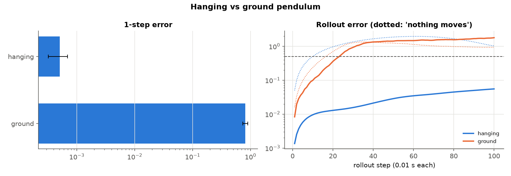

| variant | run | D | 1-step error | rollout error @25 | valid steps | test/train gap | steps touching floor |
|---|---|---|---|---|---|---|---|
| hanging | `hang_P8` | 16 | 5.09e-04 ± 1.86e-04 | 0.014 ± 0.000 | 100.0 ± 0.0 | 2.697 ± 0.726 | – |
| ground | `ground_P8` | 16 | 0.816 ± 0.084 | 0.622 ± 0.113 | 24.8 ± 1.8 | 0.977 ± 0.069 | 0.802 ± 0.004 |

## Does the model learn the floor?

*In the ground setup, do predicted rods respect the floor, and are contact steps the hard part?*

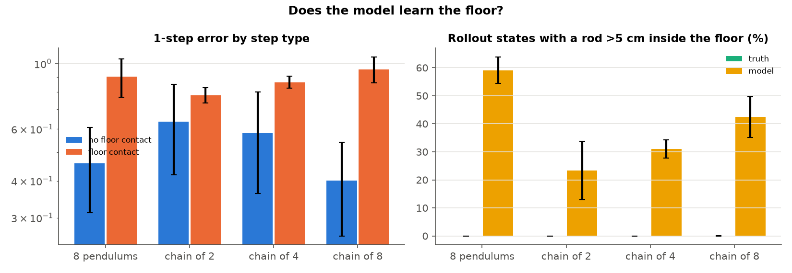

| variant | run | D | 1-step error | rollout error @25 | valid steps | test/train gap | 1-step, no contact | 1-step, contact | >5 cm in floor (truth) | >5 cm in floor (model) | deepest, model (cm) |
|---|---|---|---|---|---|---|---|---|---|---|---|
| 8 pendulums | `ground_P8` | 16 | 0.816 ± 0.084 | 0.622 ± 0.113 | 24.8 ± 1.8 | 0.977 ± 0.069 | 0.459 ± 0.147 | 0.903 ± 0.134 | 0.000 ± 0.000 | 0.591 ± 0.047 | 27.1 ± 0.8 |
| chain of 2 | `ground_L2` | 4 | 0.739 ± 0.067 | 0.357 ± 0.070 | 33.4 ± 4.1 | 0.937 ± 0.294 | 0.636 ± 0.216 | 0.781 ± 0.047 | 0.000 ± 0.000 | 0.233 ± 0.103 | 15.0 ± 3.9 |
| chain of 4 | `ground_L4` | 8 | 0.795 ± 0.075 | 0.541 ± 0.243 | 27.8 ± 3.4 | 0.998 ± 0.210 | 0.581 ± 0.219 | 0.865 ± 0.041 | 0.000 ± 0.000 | 0.310 ± 0.033 | 30.3 ± 3.0 |
| chain of 8 | `ground_L8` | 16 | 0.816 ± 0.035 | 0.653 ± 0.052 | 25.4 ± 1.5 | 1.044 ± 0.183 | 0.401 ± 0.141 | 0.956 ± 0.096 | 6.67e-05 ± 2.87e-04 | 0.424 ± 0.073 | 68.4 ± 28.1 |

## More pendulums vs longer chains

*Is it the size of the state (D) or the coupling between joints that makes prediction hard?*

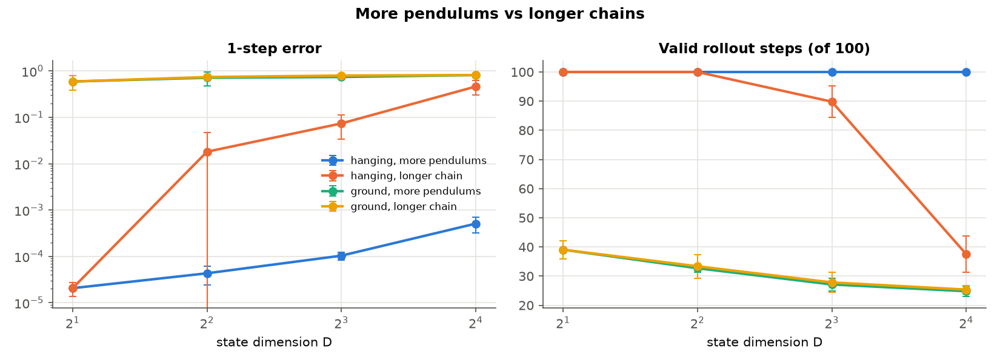

| variant | run | D | 1-step error | rollout error @25 | valid steps | test/train gap |
|---|---|---|---|---|---|---|
| hanging · 1 pendulum | `hang_P1` | 2 | 2.06e-05 ± 6.96e-06 | 2.41e-03 ± 1.37e-03 | 100.0 ± 0.0 | 1.294 ± 0.596 |
| hanging · 2 pendulums | `hang_P2` | 4 | 4.32e-05 ± 1.88e-05 | 3.55e-03 ± 8.44e-04 | 100.0 ± 0.0 | 1.481 ± 0.847 |
| hanging · 4 pendulums | `hang_P4` | 8 | 1.04e-04 ± 1.99e-05 | 5.94e-03 ± 3.30e-04 | 100.0 ± 0.0 | 1.699 ± 0.562 |
| hanging · 8 pendulums | `hang_P8` | 16 | 5.09e-04 ± 1.86e-04 | 0.014 ± 0.000 | 100.0 ± 0.0 | 2.697 ± 0.726 |
| hanging · chain of 2 | `hang_L2` | 4 | 0.018 ± 0.029 | 8.29e-03 ± 2.33e-03 | 100.0 ± 0.0 | 6.286 ± 5.507 |
| hanging · chain of 4 | `hang_L4` | 8 | 0.074 ± 0.040 | 0.063 ± 0.009 | 89.8 ± 5.4 | 2.659 ± 2.524 |
| hanging · chain of 8 | `hang_L8` | 16 | 0.461 ± 0.160 | 0.417 ± 0.125 | 37.5 ± 6.2 | 2.895 ± 2.619 |
| ground · 1 pendulum | `ground_P1` | 2 | 0.591 ± 0.204 | 0.235 ± 0.256 | 39.1 ± 3.1 | 0.925 ± 0.290 |
| ground · 2 pendulums | `ground_P2` | 4 | 0.714 ± 0.236 | 0.340 ± 0.020 | 32.7 ± 1.4 | 0.945 ± 0.385 |
| ground · 4 pendulums | `ground_P4` | 8 | 0.740 ± 0.028 | 0.546 ± 0.151 | 27.1 ± 2.2 | 0.907 ± 0.163 |
| ground · 8 pendulums | `ground_P8` | 16 | 0.816 ± 0.084 | 0.622 ± 0.113 | 24.8 ± 1.8 | 0.977 ± 0.069 |
| ground · chain of 2 | `ground_L2` | 4 | 0.739 ± 0.067 | 0.357 ± 0.070 | 33.4 ± 4.1 | 0.937 ± 0.294 |
| ground · chain of 4 | `ground_L4` | 8 | 0.795 ± 0.075 | 0.541 ± 0.243 | 27.8 ± 3.4 | 0.998 ± 0.210 |
| ground · chain of 8 | `ground_L8` | 16 | 0.816 ± 0.035 | 0.653 ± 0.052 | 25.4 ± 1.5 | 1.044 ± 0.183 |

## Flow matching vs regression, change vs next state

*Which model and which prediction target work best on the hanging setup?*

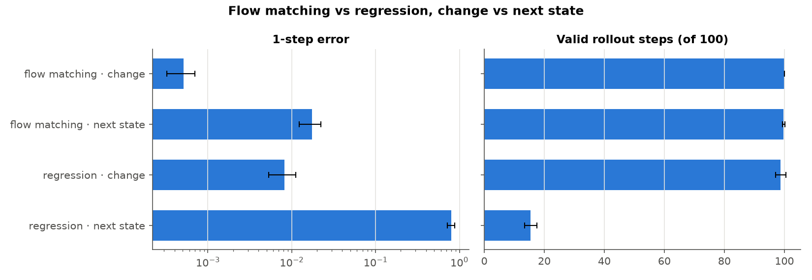

| variant | run | D | 1-step error | rollout error @25 | valid steps | test/train gap |
|---|---|---|---|---|---|---|
| flow matching · change | `hang_P8` | 16 | 5.09e-04 ± 1.86e-04 | 0.014 ± 0.000 | 100.0 ± 0.0 | 2.697 ± 0.726 |
| flow matching · next state | `hang_P8_state` | 16 | 0.017 ± 0.005 | 0.084 ± 0.013 | 99.7 ± 0.4 | 1.254 ± 0.224 |
| regression · change | `hang_P8_regression` | 16 | 8.22e-03 ± 2.88e-03 | 0.087 ± 0.011 | 98.8 ± 1.7 | 36.6 ± 7.1 |
| regression · next state | `hang_P8_regression_state` | 16 | 0.797 ± 0.082 | 0.801 ± 0.047 | 15.5 ± 2.1 | 11.5 ± 1.3 |

## Telling the model gravity

*When does it matter whether the model is told the gravity of a clip?*

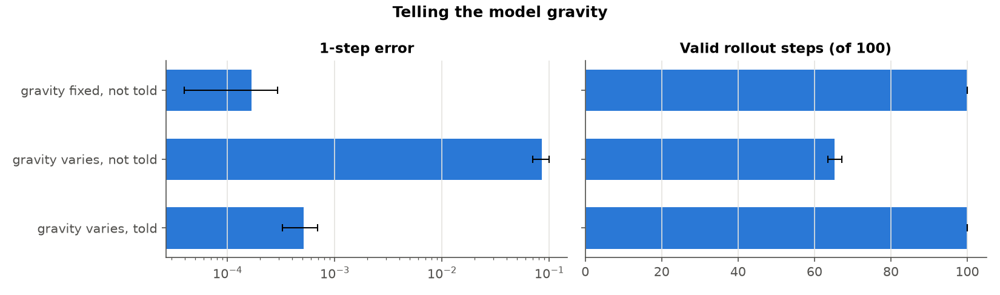

| variant | run | D | 1-step error | rollout error @25 | valid steps | test/train gap | shuffle gravity |
|---|---|---|---|---|---|---|---|
| gravity fixed, not told | `g_fixed_hidden` | 16 | 1.67e-04 ± 1.27e-04 | 4.63e-03 ± 1.02e-03 | 100.0 ± 0.0 | 1.421 ± 0.320 | – |
| gravity varies, not told | `g_hidden` | 16 | 0.085 ± 0.015 | 0.230 ± 0.062 | 65.3 ± 1.8 | 18.6 ± 10.7 | – |
| gravity varies, told | `hang_P8` | 16 | 5.09e-04 ± 1.86e-04 | 0.014 ± 0.000 | 100.0 ± 0.0 | 2.697 ± 0.726 | 216.2 ± 49.0 |

## Gravities outside the training range

*Does a model trained on gravity 4-15 work at gravity 2, 20 or 25?*

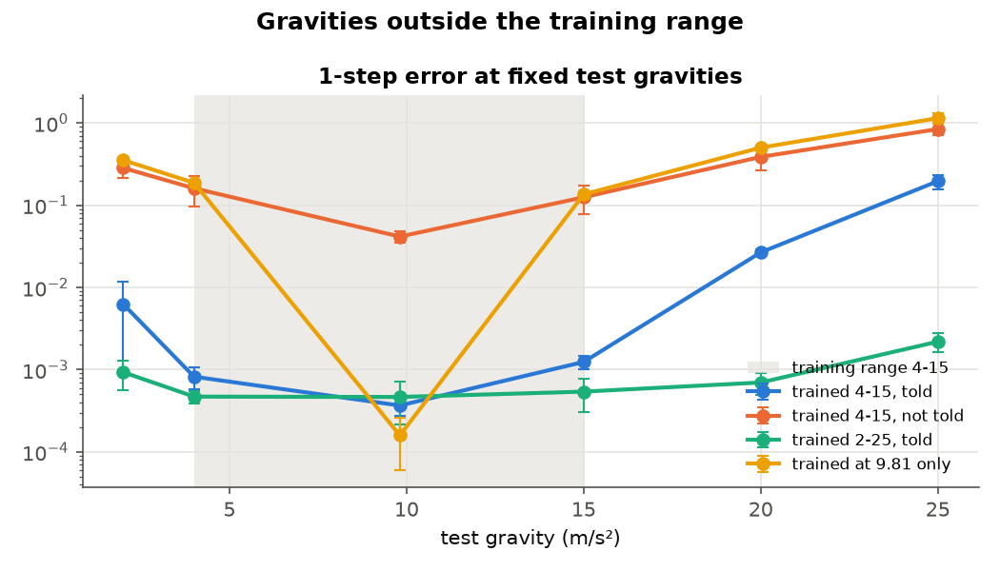

| variant | run | D | 1-step error | rollout error @25 | valid steps | test/train gap | 1-step @ g=2 | 1-step @ g=9.81 | 1-step @ g=20 | 1-step @ g=25 |
|---|---|---|---|---|---|---|---|---|---|---|
| trained 4-15, told | `hang_P8` | 16 | 5.09e-04 ± 1.86e-04 | 0.014 ± 0.000 | 100.0 ± 0.0 | 2.697 ± 0.726 | 6.27e-03 ± 5.36e-03 | 3.67e-04 ± 9.26e-05 | 0.027 ± 0.002 | 0.196 ± 0.039 |
| trained 4-15, not told | `g_hidden` | 16 | 0.085 ± 0.015 | 0.230 ± 0.062 | 65.3 ± 1.8 | 18.6 ± 10.7 | 0.283 ± 0.069 | 0.042 ± 0.006 | 0.387 ± 0.118 | 0.842 ± 0.138 |
| trained 2-25, told | `g_wide_told` | 16 | 7.62e-04 ± 1.87e-04 | 0.024 ± 0.005 | 100.0 ± 0.0 | 3.267 ± 0.922 | 9.32e-04 ± 3.66e-04 | 4.66e-04 ± 2.47e-04 | 6.99e-04 ± 2.00e-04 | 2.19e-03 ± 5.61e-04 |
| trained at 9.81 only | `g_fixed_hidden` | 16 | 1.67e-04 ± 1.27e-04 | 4.63e-03 ± 1.02e-03 | 100.0 ± 0.0 | 1.421 ± 0.320 | 0.353 ± 0.020 | 1.59e-04 ± 9.82e-05 | 0.501 ± 0.026 | 1.142 ± 0.165 |

## Joint damping

*Does friction that varies between clips hurt, and does telling the model fix it?*

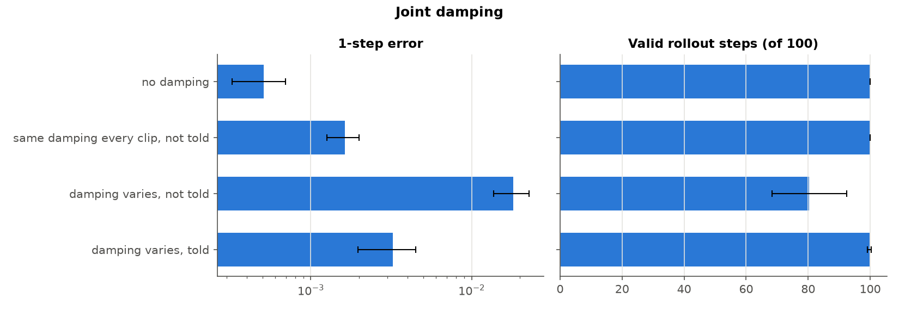

| variant | run | D | 1-step error | rollout error @25 | valid steps | test/train gap | shuffle damping |
|---|---|---|---|---|---|---|---|
| no damping | `hang_P8` | 16 | 5.09e-04 ± 1.86e-04 | 0.014 ± 0.000 | 100.0 ± 0.0 | 2.697 ± 0.726 | – |
| same damping every clip, not told | `damp_fixed_hidden` | 16 | 1.63e-03 ± 3.69e-04 | 0.053 ± 0.011 | 100.0 ± 0.0 | 5.811 ± 1.451 | – |
| damping varies, not told | `damp_hidden` | 16 | 0.018 ± 0.005 | 0.245 ± 0.044 | 80.3 ± 12.0 | 8.438 ± 1.238 | – |
| damping varies, told | `damp_told` | 16 | 3.23e-03 ± 1.27e-03 | 0.074 ± 0.006 | 99.7 ± 0.6 | 6.189 ± 2.169 | 8.029 ± 1.117 |

## Past states as context

*Do 2-5 past states help, and when?*

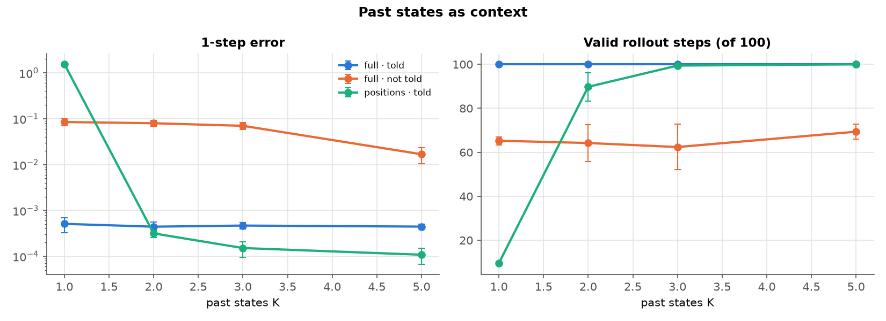

| variant | run | D | 1-step error | rollout error @25 | valid steps | test/train gap | shuffle gravity |
|---|---|---|---|---|---|---|---|
| full · told · K=1 | `hang_P8` | 16 | 5.09e-04 ± 1.86e-04 | 0.014 ± 0.000 | 100.0 ± 0.0 | 2.697 ± 0.726 | 216.2 ± 49.0 |
| full · told · K=2 | `ctx_full_told_K2` | 16 | 4.42e-04 ± 1.15e-04 | 0.014 ± 0.002 | 100.0 ± 0.0 | 2.543 ± 0.553 | 245.0 ± 45.9 |
| full · told · K=3 | `ctx_full_told_K3` | 16 | 4.67e-04 ± 7.25e-05 | 0.014 ± 0.004 | 100.0 ± 0.0 | 2.467 ± 0.520 | 225.0 ± 31.5 |
| full · told · K=5 | `ctx_full_told_K5` | 16 | 4.44e-04 ± 5.47e-05 | 0.015 ± 0.004 | 100.0 ± 0.0 | 2.426 ± 0.228 | 211.0 ± 41.3 |
| full · not told · K=1 | `g_hidden` | 16 | 0.085 ± 0.015 | 0.230 ± 0.062 | 65.3 ± 1.8 | 18.6 ± 10.7 | – |
| full · not told · K=2 | `ctx_full_hidden_K2` | 16 | 0.080 ± 0.011 | 0.228 ± 0.065 | 64.2 ± 8.3 | 28.4 ± 8.6 | – |
| full · not told · K=3 | `ctx_full_hidden_K3` | 16 | 0.070 ± 0.012 | 0.235 ± 0.036 | 62.4 ± 10.3 | 36.0 ± 10.2 | – |
| full · not told · K=5 | `ctx_full_hidden_K5` | 16 | 0.017 ± 0.006 | 0.176 ± 0.042 | 69.4 ± 3.4 | 22.4 ± 11.5 | – |
| positions · told · K=1 | `ctx_pos_told_K1` | 16 | 1.561 ± 0.041 | 1.631 ± 0.087 | 9.607 ± 0.576 | 21.6 ± 4.9 | -9.84e-03 ± 3.37e-02 |
| positions · told · K=2 | `ctx_pos_told_K2` | 16 | 3.15e-04 ± 6.08e-05 | 0.144 ± 0.011 | 89.8 ± 6.5 | 3.099 ± 0.608 | 1.975 ± 0.217 |
| positions · told · K=3 | `ctx_pos_told_K3` | 16 | 1.51e-04 ± 5.62e-05 | 0.080 ± 0.020 | 99.4 ± 0.9 | 1.795 ± 0.235 | 9.686 ± 1.748 |
| positions · told · K=5 | `ctx_pos_told_K5` | 16 | 1.08e-04 ± 4.14e-05 | 0.041 ± 0.000 | 100.0 ± 0.0 | 1.815 ± 0.247 | 39.1 ± 13.9 |

## Random nuisance tokens

*Does the model ignore meaningless random inputs, or learn from them?*

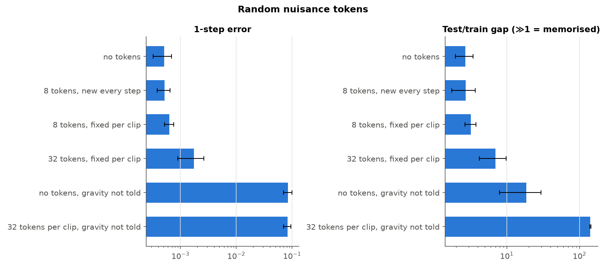

| variant | run | D | 1-step error | rollout error @25 | valid steps | test/train gap | shuffle tokens | shuffle gravity |
|---|---|---|---|---|---|---|---|---|
| no tokens | `hang_P8` | 16 | 5.09e-04 ± 1.86e-04 | 0.014 ± 0.000 | 100.0 ± 0.0 | 2.697 ± 0.726 | – | 216.2 ± 49.0 |
| 8 tokens, new every step | `tok8_step` | 16 | 5.16e-04 ± 1.34e-04 | 0.014 ± 0.005 | 100.0 ± 0.0 | 2.723 ± 0.966 | -2.43e-04 ± 1.61e-03 | 212.8 ± 49.2 |
| 8 tokens, fixed per clip | `tok8_clip` | 16 | 6.36e-04 ± 1.20e-04 | 0.017 ± 0.004 | 100.0 ± 0.0 | 3.207 ± 0.562 | 0.012 ± 0.040 | 171.0 ± 10.9 |
| 32 tokens, fixed per clip | `tok32_clip` | 16 | 1.76e-03 ± 8.66e-04 | 0.029 ± 0.002 | 100.0 ± 0.0 | 6.988 ± 2.786 | 0.024 ± 0.043 | 60.9 ± 20.0 |
| no tokens, gravity not told | `g_hidden` | 16 | 0.085 ± 0.015 | 0.230 ± 0.062 | 65.3 ± 1.8 | 18.6 ± 10.7 | – | – |
| 32 tokens per clip, gravity not told | `tok32_clip_hidden` | 16 | 0.083 ± 0.012 | 0.218 ± 0.028 | 64.0 ± 3.5 | 141.0 ± 1.9 | -0.036 ± 0.219 | – |

## Other worlds

*How do springs, cart-poles and bouncing balls compare to the hanging pendulum at the same D?*

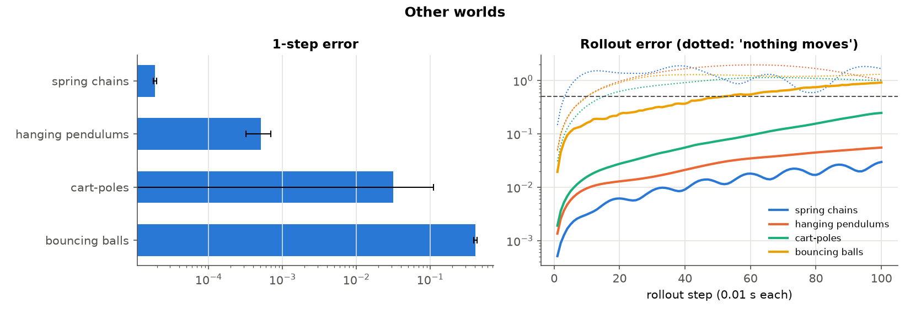

| variant | run | D | 1-step error | rollout error @25 | valid steps | test/train gap | copy baseline 1-step |
|---|---|---|---|---|---|---|---|
| spring chains | `spring_D16` | 16 | 1.89e-05 ± 1.03e-06 | 5.73e-03 ± 1.01e-03 | 100.0 ± 0.0 | 1.146 ± 0.121 | 0.996 ± 0.019 |
| hanging pendulums | `hang_P8` | 16 | 5.09e-04 ± 1.86e-04 | 0.014 ± 0.000 | 100.0 ± 0.0 | 2.697 ± 0.726 | 0.981 ± 0.141 |
| cart-poles | `cartpole_D16` | 16 | 0.032 ± 0.080 | 0.033 ± 0.014 | 96.8 ± 2.7 | 12.4 ± 28.5 | 0.977 ± 0.136 |
| bouncing balls | `balls_D16` | 16 | 0.412 ± 0.022 | 0.259 ± 0.033 | 32.1 ± 5.7 | 0.952 ± 0.186 | 0.946 ± 0.056 |

## Scaling the state: 16 to 128 dimensions

*How does the model cope as the state grows from D = 16 to 128, with independent joints and with coupled ones?*

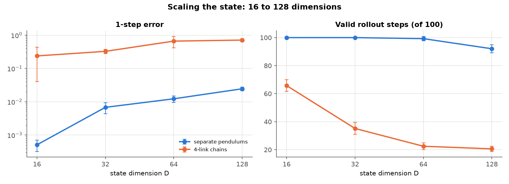

| variant | run | D | 1-step error | rollout error @25 | valid steps | test/train gap |
|---|---|---|---|---|---|---|
| separate pendulums · D=16 | `hang_P8` | 16 | 5.09e-04 ± 1.86e-04 | 0.014 ± 0.000 | 100.0 ± 0.0 | 2.697 ± 0.726 |
| separate pendulums · D=32 | `dim_P16` | 32 | 6.79e-03 ± 2.48e-03 | 0.052 ± 0.004 | 100.0 ± 0.0 | 3.752 ± 1.192 |
| separate pendulums · D=64 | `dim_P32` | 64 | 0.012 ± 0.003 | 0.072 ± 0.005 | 99.3 ± 1.5 | 2.826 ± 0.433 |
| separate pendulums · D=128 | `dim_P64` | 128 | 0.025 ± 0.003 | 0.113 ± 0.002 | 92.0 ± 2.9 | 3.159 ± 0.375 |
| 4-link chains · D=16 | `dim_L4x2` | 16 | 0.238 ± 0.198 | 0.198 ± 0.068 | 65.8 ± 4.2 | 4.847 ± 3.251 |
| 4-link chains · D=32 | `dim_L4x4` | 32 | 0.327 ± 0.050 | 0.425 ± 0.036 | 35.2 ± 4.3 | 1.827 ± 0.317 |
| 4-link chains · D=64 | `dim_L4x8` | 64 | 0.663 ± 0.247 | 0.599 ± 0.053 | 22.5 ± 2.5 | 1.625 ± 0.712 |
| 4-link chains · D=128 | `dim_L4x16` | 128 | 0.712 ± 0.078 | 0.643 ± 0.031 | 20.6 ± 1.8 | 1.264 ± 0.201 |
